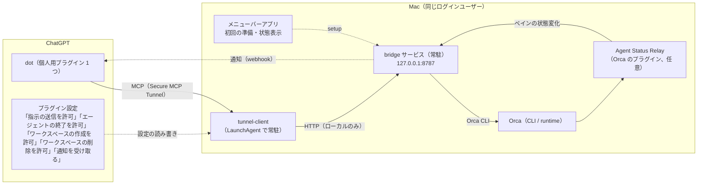

# Orca → dot bridge

[Orca](https://www.onorca.dev) で進めている AI エージェントの作業状態を、ChatGPT の音声アシスタント（dot）から確認し、必要なら指定した1つのエージェントへ追加の指示を送るための bridge です。macOS 専用です。

_A bridge that lets ChatGPT (dot) check the status of agents running in Orca on your Mac, and optionally send one explicit instruction to one agent. macOS only._

| 機能                                                                           | 状態                                                                                                                                               |
| ------------------------------------------------------------------------------ | -------------------------------------------------------------------------------------------------------------------------------------------------- |
| dot から Orca の状態を確認する                                                 | 利用可能                                                                                                                                           |
| dot から1つのエージェントへ追加の指示を送る                                    | 利用可能・既定はオフ（ChatGPT のプラグイン設定で許可。実エージェントへの送信は未検証）                                                             |
| dot からワークスペースを作る・エージェントを終了する・ワークスペースを削除する | 利用可能・3つとも既定はオフ（ChatGPT のプラグイン設定でそれぞれ許可。実環境での動作は未検証）                                                      |
| エージェントのターン終了などを dot へ自動通知する                              | Orca の experimental plugin（Agent Status Relay）を利用。ペイン単位で、既定はオフ（ChatGPT のプラグイン設定で許可）。[詳細](docs/notifications.md) |

## アーキテクチャ



- dot は 1 つの Secure MCP Tunnel で Mac 上の bridge サービスを呼びます。Tunnel クライアントは Mac から外へ接続するだけで、Mac でポートを開きません。bridge サービスが待ち受けるのは `127.0.0.1` だけです。
- bridge サービスが公開するツールは `orca_find`（名前や状態からの候補探し）、`orca_status`（状態確認）、`orca_send_instruction`（指定した1端末への追加指示）、`orca_create_workspace`（ワークスペースの作成と、任意でエージェントの起動）、`orca_close_agent`（エージェントのターミナルを閉じる）、`orca_remove_workspace`（ワークスペースの削除）、`orca_recent_notifications`（届いた通知の確認）と、ChatGPT の設定画面用の2つです。送信は「指示の送信を許可」、作成・終了・削除はそれぞれ「ワークスペースの作成を許可」「エージェントの終了を許可」「ワークスペースの削除を許可」、通知は「通知を受け取る」を ChatGPT のプラグイン管理画面でオンにしたときだけ受け付けます。どれも既定はオフで、オンにできるのはプラグイン管理画面からだけです。
- メニューバーアプリは、Tunnel ができる前の初回準備と、Tunnel が動いているかの表示を受け持ちます。設定や許可は ChatGPT 側の画面で行います。

詳しくは[アーキテクチャと実装状況](docs/architecture.md)を参照してください。

## 使い方

必要なもの: macOS、[Orca](https://www.onorca.dev)（CLI を登録済み）、ChatGPT のアカウントと [OpenAI Platform](https://platform.openai.com/) へのアクセス。

1. **アプリを入れる。** Homebrew では `brew install --cask andoshin11/tap/orca-dots-bridge` で入ります（更新は `brew upgrade --cask orca-dots-bridge`）。手動で入れる場合は、[Releases](https://github.com/andoshin11/orca-dots-bridge/releases/latest) から `Orca-Dots-Bridge-<版>-mac-arm64.zip`（Intel Mac は `-mac-x64.zip`）をダウンロードして展開し、**Finder で**「アプリケーション」フォルダへドラッグして移してから開きます。どちらの方法でも、開発者署名をしていないため、初回は「開いていません」と表示されます。「完了」を押し、「システム設定」→「プライバシーとセキュリティ」の「このまま開く」を押して、確認のダイアログで再度「このまま開く」を選び、Mac のログインパスワードを入力します（1回だけです）。
2. **アプリの画面に沿って準備する（初回だけ）。** 各手順に Platform・ChatGPT の画面のスクリーンショットがあります。
   1. Platform で Tunnel を 1 つ作り、ID を貼り付ける
   2. Platform で runtime キー（Restricted、Tunnels の Read と Use、期限付き）を作ってコピーする
   3. 「セットアップを実行」を押す（tunnel-client の導入と、bridge サービス・Tunnel のログイン時の自動起動まで行います）
   4. ChatGPT で「カスタム MCP サーバー」を 1 つ追加する（接続タイプはトンネル、認証なし）
3. **dot から使う。** 「Orca の ○○ の作業はどうなってる？」「orca-dots-bridge の debug のワークスペースは？」「入力待ちのエージェントはいる？」のように、ふだんの言葉で聞きます。正確な名前や ID を伝える必要はありません。dot が候補を探し、複数当てはまるときはどれかを確かめます。指示も送りたい場合は、ChatGPT のプラグイン管理画面で「指示の送信を許可」をオンにします。

   ワークスペースの作成（「新しいワークスペースを作って codex にこの修正を頼んで」）、エージェントの終了、ワークスペースの削除も、それぞれ「ワークスペースの作成を許可」「エージェントの終了を許可」「ワークスペースの削除を許可」をオンにすると頼めます。強い操作なので既定はオフです。作成で起動したエージェントはこの Mac 上で Orca の通常の権限で動きます。削除は元に戻せません（メインのチェックアウトと、コミットしていない変更があるワークスペースは削除しません）。実行の前に dot が内容を確認します。

4. **（任意）自動通知を使う。** Orca の「設定」→「プラグイン」→「ソースを管理」で Git のソース `https://github.com/andoshin11/orca-plugins`（ref は `main`）を追加し、**Agent Status Relay** をインストールして「プラグインを有効にする」を押します（権限は events:subscribe）。そのうえで ChatGPT のプラグイン管理画面で「通知を受け取る」をオンにします。Tunnel やプラグインを追加する必要はありません。詳しくは[自動通知](docs/notifications.md)を参照してください。

### 以前の 2 つの Tunnel の構成から移る

以前は状態確認用と通知用に Tunnel と ChatGPT プラグインを 2 つずつ使っていました。今は 1 つずつです。

1. 新しいアプリを開きます（更新後の初回起動で自動的に移行します）。CLI の場合は `node dist/setup.mjs --install-agent` を実行します。状態確認用の Tunnel ID をそのまま使い、古い LaunchAgent と profile を片付けます。
2. ChatGPT で状態確認用のプラグイン（Orca Status など）の管理画面を開き、「ツールを更新」を押します。
3. 通知用に作ったプラグインは ChatGPT で削除します。Platform の通知用 Tunnel も、不要なら削除できます。
4. dot に通知の購読をもう一度頼みます。

runtime キーの期限が近づいたら、新しいキーをコピーしてアプリの「コピーした新しいキーに入れ替える」で入れ替えます。うまく動かないときは[よくあるつまずき](docs/troubleshooting.md)を参照してください。

### CLI で使う

アプリを使わず、ターミナルから状態を確認したり `setup` を実行したりもできます。Releases の `orca-dots-bridge-<版>.tar.gz` を展開すれば、Node.js 22 以上だけで動きます。

```sh
node dist/cli.mjs status --repo <repo> --name <作業名>
pbpaste | node dist/setup.mjs --runtime-key-stdin --tunnel-id <Tunnel ID> --install-tunnel-client --install-agent
```

アプリと CLI の `setup` はどちらも同じ bridge サービスと Tunnel を設定します。片方だけを使ってください（あとから実行した方の bridge をサービスが使います）。

## ドキュメント

| 文書                                             | 内容                                                                     |
| ------------------------------------------------ | ------------------------------------------------------------------------ |
| [メニューバーアプリ](docs/menu-bar-app.md)       | 置き場所、更新、キーの扱い                                               |
| [ChatGPT（dot）から使う](docs/chatgpt-tunnel.md) | `setup` の詳細、プラグイン設定、手作業での Tunnel 構成                   |
| [CLI で使う](docs/cli.md)                        | CLI のリファレンス、MCP クライアントからの利用、状態の読み方             |
| [アーキテクチャと実装状況](docs/architecture.md) | 通信経路、認証、検証の範囲                                               |
| [自動通知](docs/notifications.md)                | 準備と使い方、仕組みと制約（[実装と検証](docs/notifications-design.md)） |
| [開発](docs/development.md)                      | ビルド、テスト、リリース                                                 |

## ライセンス

脆弱性の報告は [SECURITY.md](SECURITY.md) を参照してください。

[MIT](LICENSE)。第三者のライセンスは [THIRD_PARTY_NOTICES.md](THIRD_PARTY_NOTICES.md) と、配布物の `dist/THIRD_PARTY_LICENSES.md` を参照してください。
