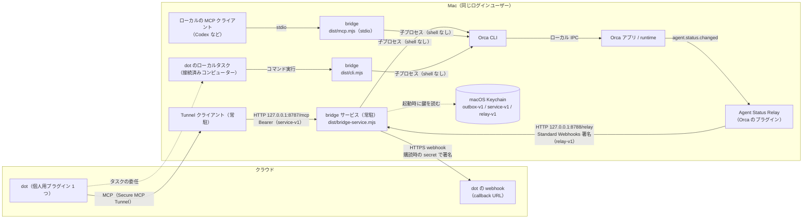

# アーキテクチャと実装状況

bridge・Orca・Tunnel クライアントは、すべて同じ Mac の同じログインユーザーで動かします。Tunnel クライアントは Mac から外へ接続するだけで、Mac 側で外部に向けてポートを開くことはありません。bridge が待ち受けるのは `127.0.0.1` だけです。

## 1 つの Tunnel と常駐の bridge サービス

dot から使う機能（状態確認・指示の送信・ChatGPT の設定画面・自動通知）は、すべて常駐の bridge サービス（`dist/bridge-service.mjs`、LaunchAgent `dev.orca-dots-bridge.service`）が 1 つの MCP エンドポイント `127.0.0.1:8787/mcp` で提供します。Tunnel は 1 つ（LaunchAgent `dev.orca-dots-bridge.tunnel`、profile `~/.orca-dots-bridge/tunnel/profiles/orca-dots-bridge.yaml`）で、ChatGPT のプラグインも 1 つです。

- bridge サービスが公開するツールは `orca_status`、`orca_send_instruction`（`expectedWorktreeId` 必須）、`orca_settings_read` / `orca_settings_update`（ChatGPT の設定画面用、OpenAI MCP Extensions の `openai/settings`）、`orca_recent_notifications` です。あわせて MCP Events（`orca.pane_turn_finished`・`orca.pane_input_required`）を提供します。
- 状態確認はいつでも使えます。指示の送信は ChatGPT のプラグイン設定「指示の送信を許可」、通知は「通知を受け取る」がオンのときだけ受け付けます（どちらも呼ばれるたびに設定を読み直します）。
- 指示の送信は、確認済みの terminal handle 1 つへの `orca terminal send` 1 回だけです。
- stdio の `dist/mcp.mjs`（CLI やローカルの MCP クライアント用）は、同じツール定義を使います。公開するツールは起動時の環境変数で決まります（既定は読み取り 6 つ）。

以前は、状態確認用の Tunnel（stdio の `dist/mcp.mjs` を起動）と通知用の Tunnel（通知サービスへ転送）を別々に使っていました。`setup --install-agent` は、その LaunchAgent（`dev.orca-dots-bridge.status-tunnel`・`dev.orca-dots-bridge.notifications`・`dev.orca-dots-bridge.notification-tunnel`）と profile を片付けて、この構成へ移します（手順は README の「以前の 2 つの Tunnel の構成から移る」）。

## 自動通知

| 区間                                | 方式                                                   | 認証・保護                                                                            |
| ----------------------------------- | ------------------------------------------------------ | ------------------------------------------------------------------------------------- |
| dot → bridge（ツール・購読）        | Tunnel → `127.0.0.1:8787/mcp`（MCP 2026-07-28）        | `Authorization: Bearer`（Keychain の `service-v1`）                                   |
| relay plugin → bridge（ペイン単位） | `127.0.0.1:8788/relay`（MCP 用とは別のポート、変更可） | Standard Webhooks 署名（`relay-v1`）、時刻 ±5 分、`webhook-id` の再送拒否             |
| bridge → Orca（ペインの再確認）     | Orca CLI の `terminal show`                            | この Mac のユーザー権限                                                               |
| bridge → dot の webhook             | HTTPS（許可したホストのみ、443、リダイレクト不可）     | Standard Webhooks 署名（購読時に dot が渡す secret）、送信待ちは `outbox-v1` で暗号化 |

- bridge サービスと Tunnel は LaunchAgent として常駐し、購読は暗号化して保存するので再起動後も続きます。購読は最大 16 件で、ChatGPT が期限（最長 1 日）の前に更新します。
- 購読と通知は、ChatGPT のプラグイン設定「通知を受け取る」がオンのときだけ受け付けます。詳しくは[自動通知](notifications.md)を参照してください。

## 自動通知（Orca の experimental plugin を利用）

常駐の bridge サービスでの使い方は[自動通知](notifications.md)を参照してください。

状態確認と明示的な指示送信とは別に、ターン終了・入力待ちの自動通知を提供します。経路は次のとおりです。

- **セッション単位（`orca.session_activity`）:** 専用RPCを追加したOrcaが必要な経路で、二段階試験の入口からだけ使えました。試験用の入口とともに削除しました（記録は[通知実装・検証範囲](notifications-design.md)と[通知試験のMac mini移行手順](archive/mac-mini-migration.md)）。
- **ペイン単位（`orca.pane_turn_finished`・`orca.pane_input_required`）:** 通常版のOrcaに、Orca の experimental plugin Agent Status Relay（[orca-plugins](https://github.com/andoshin11/orca-plugins) から入れます）を入れて使います。同じペインで始まった別のセッションの区別と、取りこぼしの検出はできません。2026-10-11に、ターン終了と入力待ちの両方がdotに届き、dotが `orca_recent_notifications` で種類を確かめて報告することを確認しました（dotには通知の中身が渡らないため）。準備と制約は[自動通知](notifications.md)を参照してください。

## 実装状況

Orca の進捗を音声アシスタントから確認するための、TypeScript 製のブリッジです。概要の読み取りと、明示した1端末への追加指示送信を提供します。CLI とローカル stdio MCP を提供します。接続済みコンピューターのローカルタスク経由で呼び出せます。Secure MCP Tunnelと個人用ChatGPTプラグインを経由するdotからの直接読み取りも検証済みです。その準備（鍵・tunnel-client・profile・LaunchAgentによる常駐）は`setup`コマンド1つで行えます。2026年10月に、状態確認用と通知用の2つのTunnelを、常駐のbridgeサービスへ転送する1つのTunnelにまとめました。dotからの指示送信は、ChatGPTのプラグイン管理画面の設定「指示の送信を許可」がオンのときだけ受け付けます（OpenAI MCP Extensionsの`openai/settings`を使用。実エージェントへの送信はまだ行っていません）。音声の往復時間は別途確認してください。[ローカル検証手順](local-validation.md) を同梱しています。

指定セッションのターン終了・入力待ちを扱う通知実装と、1対象・承認から10分で自動停止する二段階試験の入口を追加しました。通常版Orcaとrelay pluginで動くペイン単位の経路も追加しました（[自動通知](notifications.md)）。2026-10-08の隔離試験ではcallback確認・購読作成・追加承認後のイベント送信1回が成功し、製品側のwebhook起動まで確認しました。イベント種別ごとの実証とdot画面・音声での最終応答は未確認です。試験は終了し、製品側タスクも停止済みです。既存status/sendの接続は変更していません。

その後、常駐版の通知サービス（ペイン単位）を追加し、1対象・承認から10分で止まる試験用の入口（`notification-trial`・`notification-two-phase`・`notification-preflight`・`notification-approval-check`）とセッション単位の経路は削除しました。[通知実装・検証範囲](notifications-design.md)と[Mac miniへの移行手順](archive/mac-mini-migration.md)を参照してください。API-keyによる単一サービス主体は今回の限定試験で動作しましたが、本人識別や一般的な製品認証互換性を保証しません。有料Auth0を前提にしていません。[初期のMCP Events調査](archive/mcp-events-compatibility.md)は履歴として残しています。

## 実装と検証

`src/adapter.ts` は固定された4種類のOrca readコマンドと、単一端末へのterminal sendをshellを介さず呼びます。`src/contracts.ts` が `{ok,result}` とネストした `{terminal}` を検証し、`src/normalize.ts` が表示用の状態を変換します。`src/service.ts` は件数・カーソル・鮮度・エラーを扱い、CLI/MCPは同じサービスを使います。

一括送信・再送・再開・停止・削除コマンドは提供しません。既定のMCPは読み取り専用ですが、これはブリッジのAPI制限であり、接続に使用するOrca認証そのものをread-only権限に変えるものではありません。

テストは合成JSON・偽CLI・ローカルTLS受信器を使い、実エージェントや製品の通知先に接続しません。状態変換、壊れた/変化したJSON、ページング、出力制限、未導入CLI、タイムアウト、切断、失敗、ビルド済みCLI、MCP初期化とツール呼び出しを検証します。

参考にした公式資料:

- [Orca CLI reference](https://www.onorca.dev/docs/cli/reference)
- [Worktree contracts](https://github.com/stablyai/orca/blob/main/src/shared/runtime-worktree-contracts.ts)
- [Terminal contracts](https://github.com/stablyai/orca/blob/main/src/shared/runtime-terminal-contracts.ts)
- [CLI send handler](https://github.com/stablyai/orca/blob/main/src/cli/handlers/terminal-send.ts)
- [Vite+ getting started](https://viteplus.dev/guide/)
- [Vite+ pack](https://viteplus.dev/guide/pack)
- [Vite+ test](https://viteplus.dev/guide/test)

上流mainは変化するため、互換性の根拠はドキュメントだけでなくローカル1.4.220の実測JSONです。実データのログや認証情報はfixtureに保存していません。
